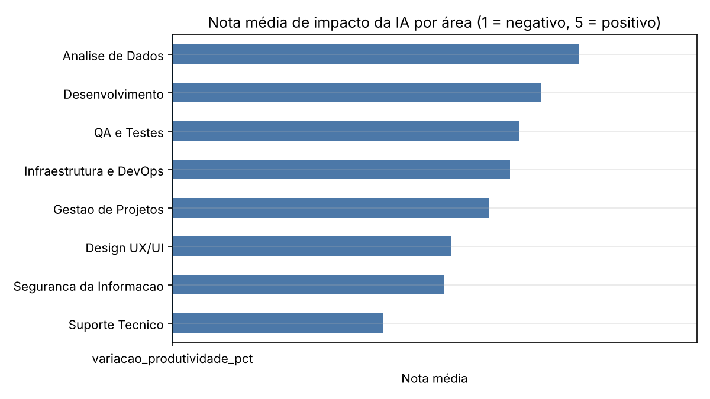
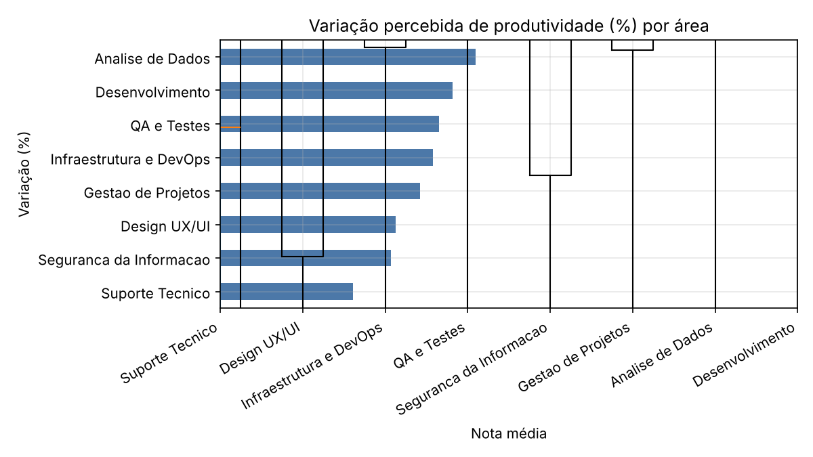
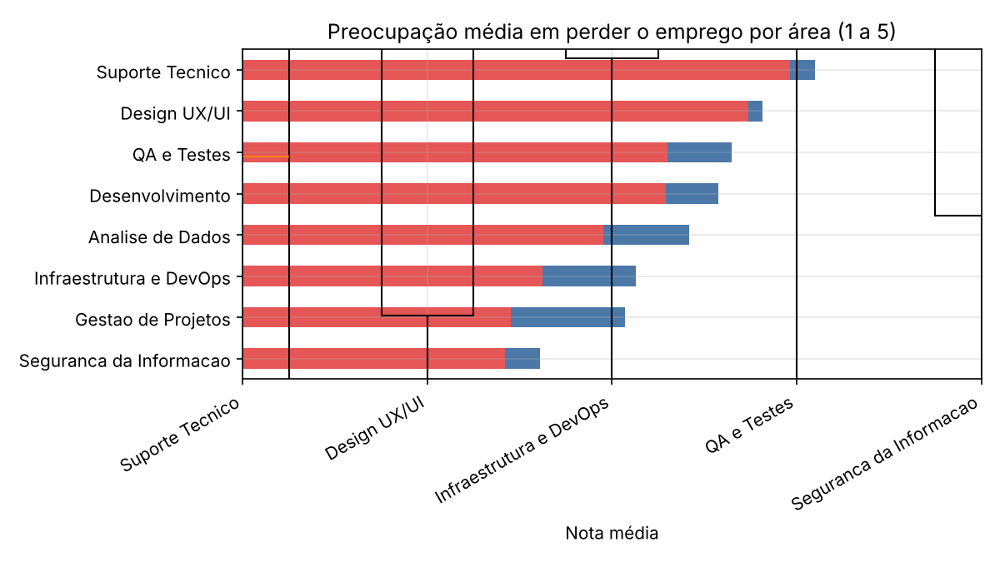
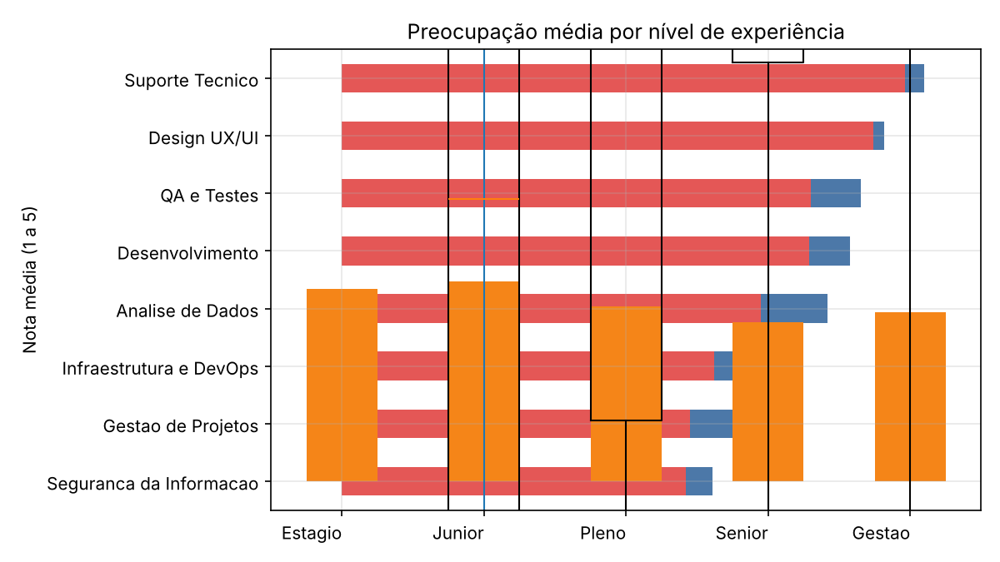

# 🤖 Impacto da IA em áreas de TI: análise exploratória

Análise exploratória de dados (EDA) em **Python (pandas)** sobre como profissionais de diferentes áreas de TI percebem o impacto da Inteligência Artificial no trabalho: se ele é positivo ou negativo, quanto muda a produtividade e quanto preocupa a segurança no emprego.

> ⚠️ **Sobre os dados:** o arquivo `dados/ia_impacto_ti.csv` é um **conjunto de dados simulado**, criado para este estudo. Ele **não vem de uma pesquisa real**, então os resultados abaixo valem apenas como exercício de análise e não representam o mercado de TI.

## 🎯 Objetivo

Praticar o ciclo completo de uma análise de dados: carregar, inspecionar, **limpar**, explorar, visualizar e comunicar as descobertas. O conjunto de dados traz problemas de qualidade de propósito (duplicados, nulos, categorias inconsistentes e outliers), para treinar também o olhar de QA sobre os dados.

## 📊 Os dados

- **406 linhas e 15 colunas** (400 linhas depois da limpeza)
- Respostas de 2023 a 2026, de 8 áreas de TI: Desenvolvimento, QA e Testes, Análise de Dados, Suporte Técnico, Infraestrutura e DevOps, Segurança da Informação, Design UX/UI e Gestão de Projetos

| Coluna | Significado |
|--------|-------------|
| `area_atuacao`, `nivel_experiencia`, `anos_experiencia` | Perfil profissional |
| `regiao`, `tipo_empresa` | Contexto de trabalho |
| `usa_ia_no_trabalho`, `frequencia_uso_ia`, `ferramenta_principal` | Uso de IA |
| `nota_impacto_ia` | Impacto percebido, de 1 (negativo) a 5 (positivo) |
| `variacao_produtividade_pct` | Mudança percebida na produtividade |
| `preocupacao_perder_emprego` | De 1 a 5 |
| `atribuicoes_mudaram`, `fez_curso_ia` | Sim ou Não |

## 🧹 Limpeza dos dados

| Problema encontrado | Tratamento |
|---------------------|------------|
| 6 linhas duplicadas | Removidas |
| Nomes de área inconsistentes (`Dev`, minúsculas, espaços extras): 12 linhas | Padronizados para os nomes oficiais |
| `anos_experiencia` impossível (-3 e 55) | Convertidos em nulo e preenchidos com a mediana do mesmo nível de experiência |
| 3 outliers de produtividade (250%, 180% e -90%) | Valores fora de -60% a +120% tratados como erro e convertidos em nulo (limite escolhido por mim) |
| Nulos em `regiao` e `tipo_empresa` | Marcados como "Nao informado" |
| Nulos em `ferramenta_principal` | Esperados, porque quem não usa IA não tem ferramenta; marcados como "Nao usa IA" |
| Nulos em `variacao_produtividade_pct` | Mantidos como nulos, sem inventar valores |

## 🔎 Perguntas e descobertas

### 1. Quais áreas percebem o impacto mais positivo e quais o mais negativo?



**Análise de Dados** tem a maior nota média (4,10), seguida de Desenvolvimento (3,82) e QA e Testes (3,65). **Suporte Técnico** tem a menor (2,61), e é a única área abaixo de 3 pontos.

### 2. A variação de produtividade muda conforme a área?



Sim. A mediana do ganho de produtividade vai de cerca de **28% em Desenvolvimento** e 25% em Análise de Dados até apenas **5% em Suporte Técnico**.

### 3. Em quais áreas a preocupação em perder o emprego é maior?



As maiores notas são de **Suporte Técnico (3,96)** e **Design UX/UI (3,74)**. As menores são de Segurança da Informação (2,42) e Gestão de Projetos (2,45). Ou seja, onde o impacto é menos positivo, a preocupação é maior.

### 4. Estagiários e juniores se preocupam mais do que seniores?



Sim. Juniores (3,47) e estagiários (3,34) se preocupam mais do que seniores (2,77), com plenos no meio (3,04).

### 5. Em quais áreas as atribuições mais mudaram?

**Design UX/UI** lidera, com 52% das pessoas dizendo que suas atribuições mudaram, e **Análise de Dados** é a que menos mudou (33%).

### 6. Quem usa IA com mais frequência percebe um impacto melhor?

Em parte. Quem **nunca usa** IA dá a pior nota (2,57), contra cerca de 3,6 de quem usa. Mas entre quem usa, a frequência pouco muda a nota: raramente (3,57), semanal (3,70) e diário (3,57).

### 7. Fazer curso de IA está ligado a mais impacto positivo e menos preocupação?

Não neste conjunto de dados. Quem fez curso tem nota de impacto 3,52 contra 3,49 de quem não fez, e preocupação 3,11 contra 3,13. A diferença é pequena demais para concluir algo.

### 8. Quais ferramentas são mais usadas em cada área?

No geral, entre quem usa IA: ChatGPT (37%), GitHub Copilot (29%), Gemini (17%) e Claude (13%). O ChatGPT lidera em Design UX/UI (50%), e o GitHub Copilot lidera em Análise de Dados e Suporte Técnico (35% cada).

### 9. Como o uso e a preocupação mudaram de 2023 a 2026?

O uso de IA no trabalho subiu de **79% (2023) para 92% (2026)**, e a preocupação média em perder o emprego subiu de **3,03 para 3,25**. A quantidade de respostas é menor em 2023 (58), então esse ano pesa menos na conclusão.

### 10. Há diferença por região ou tipo de empresa?

As diferenças são pequenas. A nota de impacto fica entre 3,40 e 3,64 nas regiões (Sul no topo). Por tipo de empresa, freelancers têm a menor preocupação (2,82) e empresas grandes a maior (3,23). Algumas regiões têm poucas respostas (Norte: 20), então essas comparações são frágeis.

## ⚠️ Limitações

- Os dados são simulados, e as relações encontradas foram em parte definidas na criação deles.
- As respostas são percepções pessoais, não medições.
- Alguns grupos têm poucas respostas (região, tipo de empresa, ano de 2023).
- Diferenças entre grupos não provam relação de causa.

## 🛠️ Tecnologias

- Python
- pandas
- matplotlib
- Jupyter Notebook

## 📁 Estrutura do repositório

```
Analise_impacto_IA_TI/
├── dados/
│   ├── ia_impacto_ti.csv          # dados originais (simulados)
│   └── ia_impacto_ti_limpo.csv    # gerado pelo notebook após a limpeza
├── notebooks/
│   └── analise.ipynb
├── imagens/                       # gráficos gerados pelo notebook
├── requirements.txt
└── README.md
```

## 🚀 Como executar

1. Clone o repositório:
   ```bash
   git clone https://github.com/LucasNegri7/Analise_impacto_IA_TI.git
   cd Analise_impacto_IA_TI
   ```
2. Instale as dependências:
   ```bash
   pip install -r requirements.txt
   ```
3. Abra o notebook:
   ```bash
   jupyter notebook notebooks/analise.ipynb
   ```
4. Execute todas as células (`Kernel > Restart & Run All`).

## 👤 Autor

Desenvolvido por **Lucas Negri**  
GitHub: [@LucasNegri7](https://github.com/LucasNegri7)
